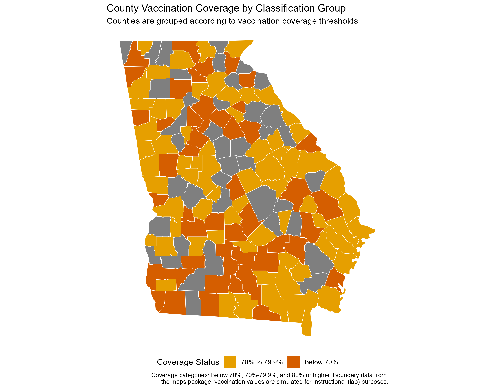
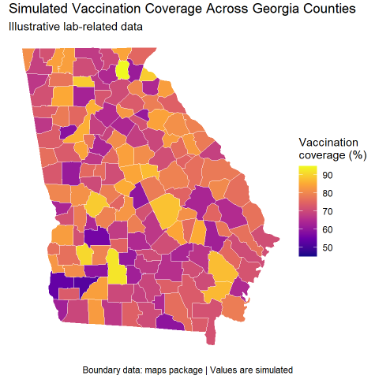

## Overview

### Inquiry

Where are simulated childhood vaccination rates lowest across Georgia counties, and how may clinic locations influence future community health outreach decisions?

### Context

Geographic information systems (GIS) help community health professionals understand how outcomes and resources vary across place. This project demonstrates how choropleth, point, proportional-symbol, and interactive maps can be used to visualize county-level patterns.

### Data Source

Georgia county boundaries were obtained through the maps package. Vaccination rates, child population estimates, clinic locations, and annual visits were simulated for instructional purposes. 

## Methods

- Created Georgia county polygons using sf
- Simulated vaccination coverage and child population values
- Joined health attributes to county boundaries
- Developed choropleth maps, point maps, and proportional-symbol maps
- Constructed an interactive Leaflet map 

## Displayed Maps

{.section-header-one .section-header-yellow} 

 

## Interpretation

The classified choropleth map, the first one reveals substantial geographic variation in simulated county vaccination coverage. While many counties were grouped within the 70% to 79.9% coverage range, a considerable number fell below the 70% threshold, indicating potential gaps in vaccination uptake. Counties with lower coverage appeared in multiple parts of the state rather than being limited to one geographic area, suggesting that challenges to vaccination may affect diverse communities. The map provides a useful screening tool for identifying locations that may warrant additional investigation, resource allocation, or health communication interventions. However, the visualization alone does not explain why coverage differs across counties and should not be used to infer causal relationships. 

The second image demonstrates the simulated vaccination coverage varied considerably across Georgia counties, with both higher- and lower-coverage areas appearing throughout the state. The map suggests that vaccination levels were not uniform across counties and may help identify locations that warrant additional monitoring or outreach efforts. 

## Limitations

The vaccination coverage values shown in this map are simulated and should not be interpreted as real public health measurements. Furthermore, because the data are presented at the county level, observed geographic differences may not accurately represent the experiences or characteristics of individuals living within those counties.

## Accessibility Information

Accessibility was supported by providing alternatives of static map, distinct legends, descriptive captions, and written interpretations alongside interactive visualizations. With these, crucial geographic findings can be grasped without requiring mouse-based interactions, clicking, or hovering, thereby improving usability for a larger audience.  