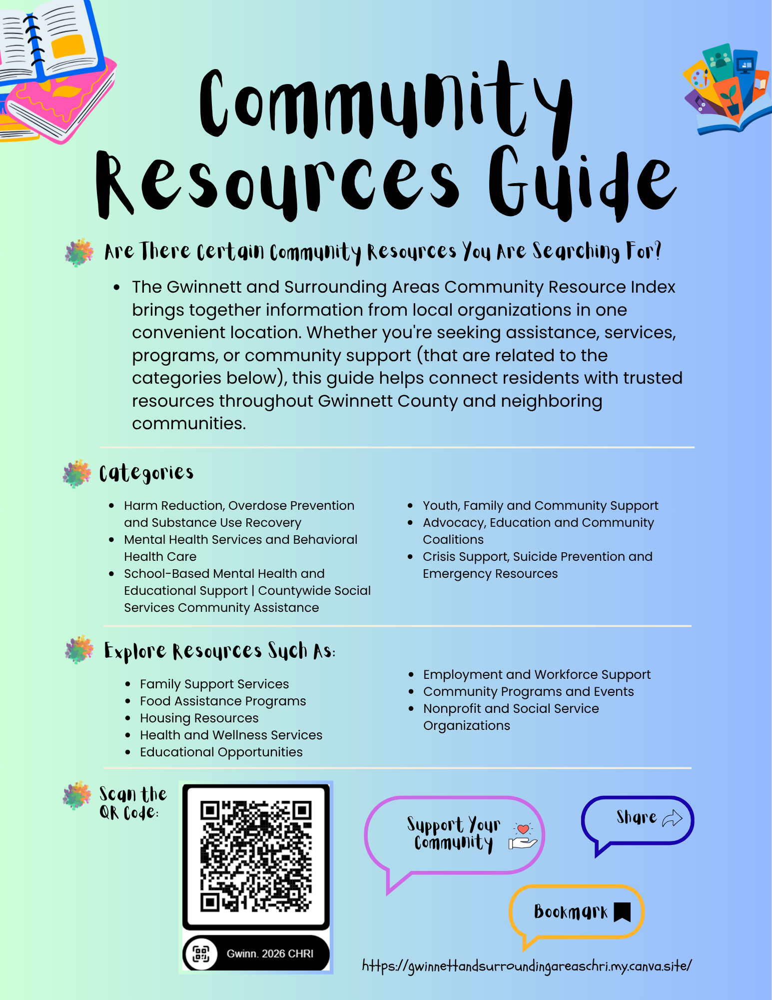
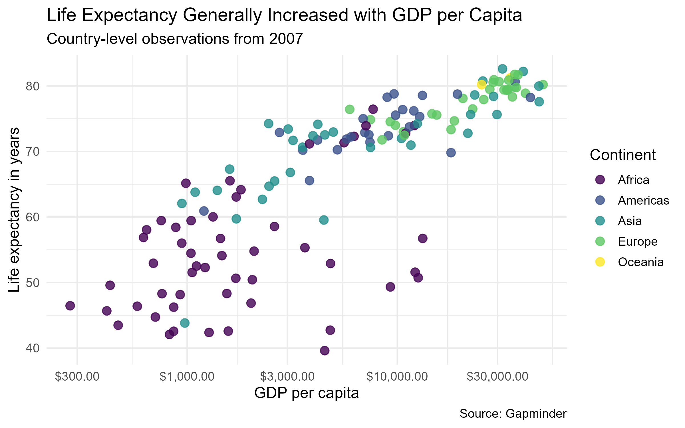
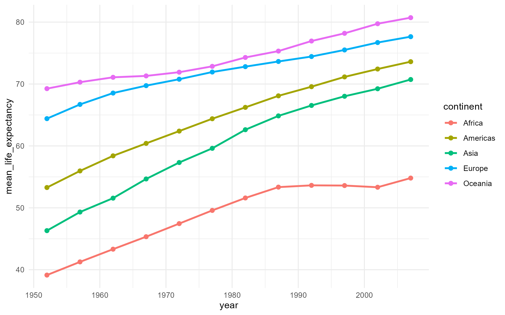

This page illustrates past and current projects relating to community health impact, data analysis, health communication, and data visualization.

## Gwinnett and Surrounding Resource Website

A public-oriented resource directory with gathered information from organizations across Gwinnett and nearby areas. It includes local services, programs, and support resources all in one place for community members.


[Explore the site and its categories](https://gwinnettandsurroundingareaschri.my.canva.site/)

### Gwinnett and Surrounding Resource Flyer

You can help spread the word by sharing the flyer below. 

## DeeFam Inc. Comic Design

Follow the comic's narrative, which addresses myths about suicide and harms from firearms, as well as underscores the importance of checking in. Material derived from the Georgia Department of Behavioral Health and Developmental Disabilities (DBHDD).


[Read the comic here or view directly below by clicking the play button.](https://heyzine.com/flip-book/1202f80a75.html)


<video class="full-video" controls> <source src="files/deefam-comic-video.mp4" type="video/mp4"> Your browser does not support the video tag. </video>


## Interactive Data Visualization with Plotly

### Public Health Question

How does GDP per capita relate to life expectancy across countries, and how have life expectancy trends changed across continents over time?

This project was developed using R, Quatro, Plotly, and the Gapminder dataset to examine global health and economic indicators. The visualizations allow individuals to investigate individual countries while maintaining visibility of larger population-level trends. 

### Interactive Scatterplot

The scatterplot displays the relationship between GDP per capita and life expectancy among countries in 2007.

```{r}
#| echo: false
#| warning: false
#| message: false

library(tidyverse)
library(gapminder)
library(plotly)
library(DT)
library(scales)
library (viridis)

gapminder_data <- gapminder %>%
  rename(
    life_expectancy = lifeExp,
    population = pop,
    gdp_per_capita = gdpPercap
  )

gapminder_2007 <- gapminder_data %>%
  filter(year == 2007)

interactive_scatterplot <- ggplot(
  data = gapminder_2007,
  mapping = aes(
    x = gdp_per_capita,
    y = life_expectancy,
    color = continent,
    text = paste0(
      "<b>", country, "</b>",
      "<br>Continent: ", continent,
      "<br>Life expectancy: ",
      round(life_expectancy, 1),
      " years",
      "<br>GDP per capita: ",
      scales::dollar(round(gdp_per_capita)),
      "<br>Population: ",
      scales::comma(population)
    )
  )
) +
  geom_point(
    size = 3,
    alpha = 0.8
  ) +
  scale_x_log10(
    labels = scales::label_dollar()
  ) +
  scale_color_viridis_d() +
  labs(
    title = "Explore Life Expectancy and GDP per Capita",
    subtitle = "Hover over a point to inspect a country",
    x = "GDP per capita",
    y = "Life expectancy in years",
    color = "Continent"
  ) +
  theme_minimal(base_size = 13)

ggplotly(
  interactive_scatterplot,
  tooltip = "text"
) %>%
  config(
    displaylogo = FALSE,
    responsive = TRUE
  )
```

#### How to Use

- Hover over a point to view country-level details.
- Click continent names in the legend to hide or display groups. 
- Zoom into dense areas using the Plotly toolbar.
- Double-click to reset the display.

### Interactive Trend Visualization

This visualization shows changes in mean country-life expectancy over time for each continent. 

```{r}
#| echo: false

continent_trends <- gapminder_data %>%
  group_by(continent, year) %>%
  summarize(
    mean_life_expectancy =
      mean(
        life_expectancy,
        na.rm = TRUE
      ),
    .groups = "drop"
  )

interactive_trend <- ggplot(
  continent_trends,
  aes(
    x = year,
    y = mean_life_expectancy,
    color = continent,
    text = paste0(
      "<b>", continent, "</b>",
      "<br>Year: ", year,
      "<br>Mean life expectancy: ",
      round(mean_life_expectancy, 1),
      " years"
    )
  )
) +
  geom_line(linewidth = 1) +
  geom_point(size = 1.8) +
  scale_color_viridis_d() +
  labs(
    title = "Mean Life Expectancy Increased Across Continents",
    subtitle = "Hover over a point or zoom into a time period",
    x = "Year",
    y = "Mean life expectancy in years"
  ) +
  theme_minimal(base_size = 13)

ggplotly(
  interactive_trend,
  tooltip = "text",
  dynamicTicks = TRUE
) %>%
  layout(
    hovermode = "x unified"
  ) %>%
  config(
    displaylogo = FALSE,
    responsive = TRUE
  )
```

#### Why Interactivity Helps

The unified hover feature allows user to compare all continents during the same year without cluttering the figure with additional labels. 

### Searchable Country-Level Data Table

The table complements the visualizations by providing exact country-level values and search functionality. 

```{r}
#| echo: false

table_data <- gapminder_2007 %>%
  transmute(
    Country = country,
    Continent = continent,
    `Life expectancy` =
      round(life_expectancy, 1),
    `GDP per capita` =
      round(gdp_per_capita),
    Population = population
  )

datatable(
  table_data,
  rownames = FALSE,
  filter = "top",
  extensions = "Buttons",
  options = list(
    pageLength = 10,
    autoWidth = TRUE,
    dom = "Bfrtip",
    buttons = c(
      "copy",
      "csv",
      "excel"
    )
  ),
  caption =
    htmltools::tags$caption(
      style =
        "caption-side: top; text-align: left;",
      "Country-level indicators in 2007"
    )
) %>%
  formatCurrency(
    columns = "GDP per capita",
    currency = "$",
    digits = 0
  ) %>%
  formatRound(
    columns = "Life expectancy",
    digits = 1
  ) %>%
  formatRound(
    columns = "Population",
    digits = 0
  ) 
```

### Interpretation

Countries with higher GDP per capita generally experience longer life expectancy, although notable variation remains among countries with similar income levels. Across continents, life expectancy increased over time, though the rate of improvement varied among regions. 

### Accessibility Information 

This project includes interactive visualizations, written summaries, searchable tables, and static alternatives. There are findings that are also provided without requiring hover interactions. For instance, static versions of the figures and downloadable data are provided to support accessibility and independent review.  

### Static Figure Alternatives

#### GDP per Capita and Life Expectancy

 

#### Life Expectancy Trends by Continent

 

#### Downloadable Dataset

[Download Gapminder 2007 Dataset](files/gapminder_2007.csv) 


### Additional Visualizations

Additional visualizations can be found on my GitHub repository. *Navigate through the data visualization course repository to see some of the other visualizations created using R, Quarto, and ggplot2.*

[Visit my GitHub](https://github.com/Damilare-Adekunle1). 
